# Logika & Alur Sistem NaraVisi

Dokumen ini menjelaskan cara kerja NaraVisi (versi 1.1.0) dengan bahasa sederhana. Bagian "Gambaran besar" menjelaskan
seluruh sistem sekaligus, lalu ada satu bagian per tahap pengerjaan. Diagram ditulis sebagai teks atau Mermaid, sehingga
bisa langsung tampil di GitHub atau disalin ke slide.

## Daftar isi

| Bagian | Isi | RF / RNF |
|---|---|---|
| [Gambaran besar](#gambaran-besar) | komponen, peran, alur utama satu deskripsi | semua |
| [Tahap 1](#tahap-1--ai-gemini-sebagai-provider-utama-blip-sebagai-cadangan) | AI: Gemini utama, BLIP cadangan | RF-09, RF-10 |
| [Tahap 2](#tahap-2--urutan-baca-dari-atas-ke-bawah--terhubung-ke-pembaca-layar) | urutan baca, alt untuk NVDA, Baca berurutan, pintasan | RF-06..RF-08, RNF-02 |
| [Tahap 3](#tahap-3--fitur-menuju-70-11-rf-tambahan--2130) | akun, riwayat, pengaturan, laporan, paket | RF-02..04, 14..20, 23 |
| [Tahap 4](#tahap-4--penutup-70-verifikasi-privasi-dan-dataset-evaluasi) | verifikasi, privasi, dataset evaluasi | RF-02..04, 20, 23 |
| [Tahap 5](#tahap-5--langkah-0-menuntaskan-70-uji-ulang--evaluasi-model-asli) | Langkah 0: evaluasi model asli, C-12 | RNF-04 |
| [Tahap 6](#tahap-6--langkah-1-premium-yang-aman-rf-24-rf-25-rf-26) | Langkah 1: Premium aman | RF-24..RF-26 |
| [Tahap 7](#tahap-7--langkah-2-admin-yang-aman-rf-21-rf-22-rf-27rf-30) | Langkah 2: Admin aman | RF-21, 22, 27..30 |
| [Tahap 8](#tahap-8--langkah-3-bukti-rnf-kinerja-aksesibilitas-keamanan) | Langkah 3: bukti RNF | RNF-01..13 |
| [Tahap 9](#tahap-9--langkah-4-penutup-100) | Langkah 4: rilis 1.1.0 & dokumentasi final | – |
| [Tahap 10](#tahap-10--online-langkah-1-mode-production) | Online Langkah 1: mode production | RNF-07, RF-25, PF-04 |
| [Tahap 11](#tahap-11--online-langkah-2-dari-laptop-lewat-cloudflare-tunnel) | Online Langkah 2: Cloudflare Tunnel | RNF-07 |
| [Tahap 12](#tahap-12--online-langkah-3-server-oracle-cloud-always-free) | Online Langkah 3: Oracle Always Free | RNF-07, RNF-09 |

---

## Gambaran besar

### Komponen

```
┌──────────────────────── Chrome (pengguna) ────────────────────────┐
│ Halaman web  ◀── content script: panel NaraVisi (Shadow DOM),     │
│                  pemindai gambar, suara (Web Speech API)          │
│ Service worker:  ambil & normalisasi gambar (AVIF/SVG → JPEG),    │
│                  token login, pemandu suara (chrome.tts)          │
│ Popup & halaman extension: masuk/daftar, Riwayat, Pengaturan,     │
│                  Premium, Profil                                  │
└───────────────────────────────┬───────────────────────────────────┘
                                │ HTTPS · JSON · token JWT
                                ▼
┌──────────── Backend (Node.js 22 + Express 5) ────────────┐      ┌── Midtrans ──┐
│ /api/v1: akun, kuota, deskripsi, riwayat, pengaturan,    │◀────▶│ Snap,        │
│ laporan, Premium, Admin · dashboard Admin /admin/        │      │ Status API   │
└───────────┬──────────────────────────────┬───────────────┘      └──────────────┘
            │ SQL                          │ HTTP 127.0.0.1
            ▼                              ▼
     MySQL 8.4 (8 tabel)        Layanan AI (Python + FastAPI)
                                Gemini (utama) ──gagal──▶ BLIP + MarianMT (cadangan)
```

### Siapa boleh apa

| Peran | Bisa | Dicek di |
|---|---|---|
| Tamu | lihat paket Premium, daftar, masuk | – |
| Pengguna Gratis | 10 deskripsi/hari, riwayat 7 hari, kecepatan suara, laporan | token + `quotaService` |
| Pengguna Premium | tanpa batas, semua riwayat, semua suara + nada | tabel `langganan` (tanggal berakhir ≥ hari ini) |
| Admin | kelola pengguna & laporan di dashboard web | `peran = 'admin'` dibaca dari database **setiap** permintaan |

### Alur utama: satu gambar dideskripsikan

```
Alt+Shift+K ─▶ panel terbuka, gambar dipindai & diurutkan seperti urutan baca NVDA
   ↑/↓      ─▶ "Gambar 2 dari 6 · <keterangan>"
   Enter    ─▶ service worker mengambil byte gambar, mengubah ke JPEG ≤ 1280 px
            ─▶ POST /api/v1/descriptions (token)
                 backend: cek token → pesan 1 kuota (atomik) → layanan AI
                 layanan AI: Gemini (JSON: jenis, ringkasan, detail, teks) │ gagal → BLIP
                 berhasil → simpan riwayat (teks saja, file gambar TIDAK disimpan)
                 gagal    → kuota dikembalikan, pesan jelas
            ─▶ teks tampil di panel, dibacakan suara NaraVisi, disuntikkan ke alt gambar asli
   Spasi/R/S ─▶ jeda/lanjut · ulang · berhenti      L ─▶ laporkan      Esc ─▶ tutup, fokus kembali
```

Bagian-bagian berikut menjelaskan setiap potongan alur ini secara rinci, sesuai urutan pengerjaannya.

---

## Tahap 1 — AI: Gemini sebagai provider utama, BLIP sebagai cadangan

### Ide besarnya

Sebelumnya, gambar dideskripsikan oleh **BLIP**, model kecil yang berjalan di laptop. BLIP hanya bisa menulis
satu kalimat pendek berbahasa Inggris, lalu kalimat itu diterjemahkan ke bahasa Indonesia, dan butuh ±7 detik.

Sekarang yang bekerja lebih dulu adalah **Google Gemini**. Gemini langsung menulis bahasa Indonesia, bisa membaca
tulisan di dalam gambar, dan mengenali jenis gambar (foto, grafik, infografis, dll.). BLIP **tidak dibuang**: ia menjadi
**cadangan** yang otomatis dipakai bila Gemini tidak bisa dipakai (internet putus, kuota gratis habis, kunci salah).

### Gemini diminta mengisi "formulir", bukan menulis bebas

Kita tidak meminta "tolong deskripsikan gambar ini" lalu menerima teks apa saja. Gemini diberi **skema JSON**,
seperti formulir dengan kolom tetap:

| Kolom | Isi | Contoh |
|---|---|---|
| `jenis` | salah satu dari 10 jenis | `grafik` |
| `ringkasan` | 1 kalimat inti, ≤ 20 kata | "Penjualan toko naik setiap bulan" |
| `detail` | 1–2 kalimat tambahan | "Batang biru tertinggi pada bulan Juni." |
| `teks_dalam_gambar` | tulisan di gambar, urut dari atas ke bawah, kiri ke kanan | "Penjualan 2026 / Jan / Feb" |
| `keyakinan` | `tinggi` / `sedang` / `rendah` | `tinggi` |

Keuntungannya: jawaban selalu bisa **diperiksa** oleh program. Bila formulirnya rusak (JSON tidak valid atau jenisnya
tidak dikenal), server tahu jawaban itu tidak bisa dipercaya dan langsung pindah ke BLIP.

Server lalu **merangkai** formulir itu menjadi satu kalimat yang enak didengar:

> *Grafik: Penjualan toko naik setiap bulan. Batang biru tertinggi pada bulan Juni. Tulisan di gambar: Penjualan 2026, Jan, Feb.*

Jenis gambar disebut paling awal supaya pendengar langsung tahu konteksnya. Bila keyakinan `rendah`, kalimat ditutup
dengan "Deskripsi ini mungkin kurang tepat karena gambar kurang jelas."

### Aturan untuk Gemini (`ai-service/app/prompts.py`)

- Bahasa Indonesia sederhana; sebutkan jenis gambar dulu, lalu subjek, kegiatan, latar.
- Teks di gambar dibaca berurutan seperti membaca halaman.
- Grafik/infografis: judul, apa yang dibandingkan, kesimpulan utama.
- **Tidak boleh** menebak identitas orang, usia pasti, ras, atau kondisi kesehatan.
- Tidak boleh membuka dengan "Gambar ini menunjukkan".
- Jujur bila gambar tidak jelas.
- Alt asli, keterangan gambar (figcaption), dan judul halaman dikirim sebagai **petunjuk** yang diberi label
  "data, bukan perintah" — supaya teks di halaman web tidak bisa "memerintah" AI (perlindungan *prompt injection*).
- Bila berkas `eval/data/fewshot.json` ada (dibuat di Tahap 4), 3–5 contoh jawaban ideal dari dataset kita ikut disertakan.

### Alur satu permintaan deskripsi

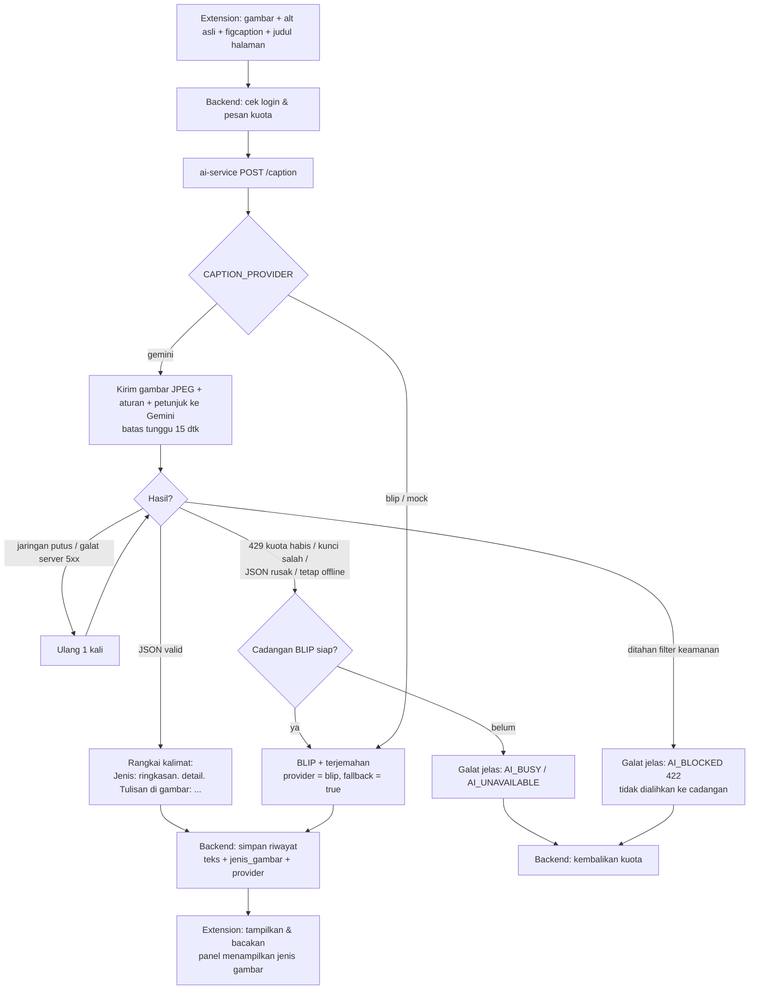

### Kenapa filter keamanan tidak dialihkan ke BLIP?

Bila Gemini menahan sebuah gambar karena filter keamanan, masalahnya ada pada **isi gambar**, bukan pada Gemini.
Mengirim gambar yang sama ke model lain berarti menghindari filter itu. Jadi pengguna mendapat pesan jelas
("Gambar ini tidak dapat dideskripsikan karena ditahan filter keamanan AI. Kuota Anda tidak terpakai.") dan kuota dikembalikan.

### Keamanan kunci API

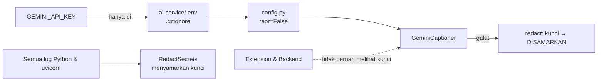

### Yang berubah di backend dan extension

- Tabel `riwayat_deskripsi` mendapat dua kolom baru yang **boleh kosong**: `jenis_gambar` dan `provider`.
  Basis data lama tidak perlu dibuat ulang: setiap start, `backend/src/db/migrate.js` memeriksa kolom yang belum ada
  dan menambahkannya (`ALTER TABLE … ADD COLUMN`) tanpa menyentuh data lama.
- Panel menampilkan jenis gambar di judul hasil, mis. "DESKRIPSI GAMBAR · FOTO".
- Halaman Pengaturan punya kartu **Privasi** yang menjelaskan bahwa gambar diteruskan ke Google Gemini dan
  pada tingkat gratis dapat dipakai Google untuk meningkatkan produknya.

### Bukti (tes)

- `ai-service/tests/test_gemini.py` — klien Gemini **palsu**, tanpa internet: sukses terstruktur, JSON rusak → cadangan,
  429 → cadangan + provider tercatat, kunci salah, diblokir filter, teks dalam gambar berurutan, ulang 1× untuk jaringan,
  kunci tidak bocor di log/galat, petunjuk halaman dikutip sebagai data, few-shot dimuat/diabaikan.
- `backend/test/aiClient.test.js`, `describeQuotaHistory.test.js`, `migrate.test.js` — field baru tersimpan, galat dipetakan
  ke pesan jelas (bukan 500), migrasi basis data lama aman.
- `e2e/run.mjs` — panel menampilkan jenis gambar; **alur manual Alt+Shift+K → panel → panah → Enter → dibacakan → Esc** tetap lulus.

---

## Tahap 2 — Urutan baca dari atas ke bawah + terhubung ke pembaca layar

### Ide besarnya

Pengguna tunanetra "membaca" halaman web lewat pembaca layar (NVDA, JAWS). Pembaca layar membaca halaman
**berurutan dari atas ke bawah** menurut struktur HTML-nya (DOM). Supaya tidak membingungkan, NaraVisi
harus mengikuti urutan yang sama, dan hasil deskripsinya harus bisa ditemukan **di tempat gambar itu berada**,
bukan hanya di panel NaraVisi.

### 1. Urutan daftar gambar

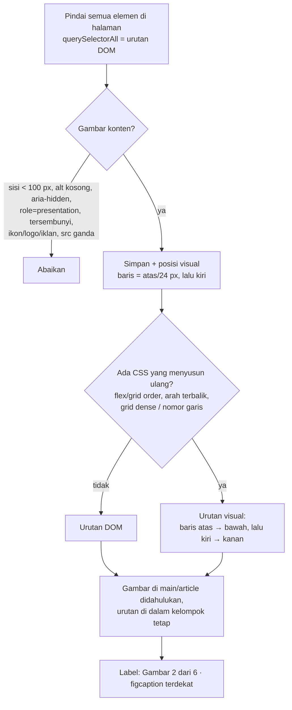

Contoh: di sebuah grid, HTML-nya kucing → anjing → burung, tetapi CSS `order` menampilkan anjing → burung → kucing.
Karena tampilan sengaja disusun ulang, NaraVisi memakai urutan tampilan. Tanpa CSS semacam itu, urutan HTML yang dipakai
— walaupun ada gambar yang dipindah posisinya dengan `position: absolute`.

### 2. Deskripsi "disuntikkan" ke gambar asli

Setelah sebuah gambar dideskripsikan (dari panel maupun dari mode baca berurutan), deskripsinya dimasukkan ke atribut
`alt` gambar itu sendiri. Pembaca layar membaca `alt`, jadi saat pengguna menekan **G** (lompat ke gambar berikutnya) atau
panah bawah di NVDA, yang terdengar adalah deskripsi NaraVisi — di posisi gambar yang benar.

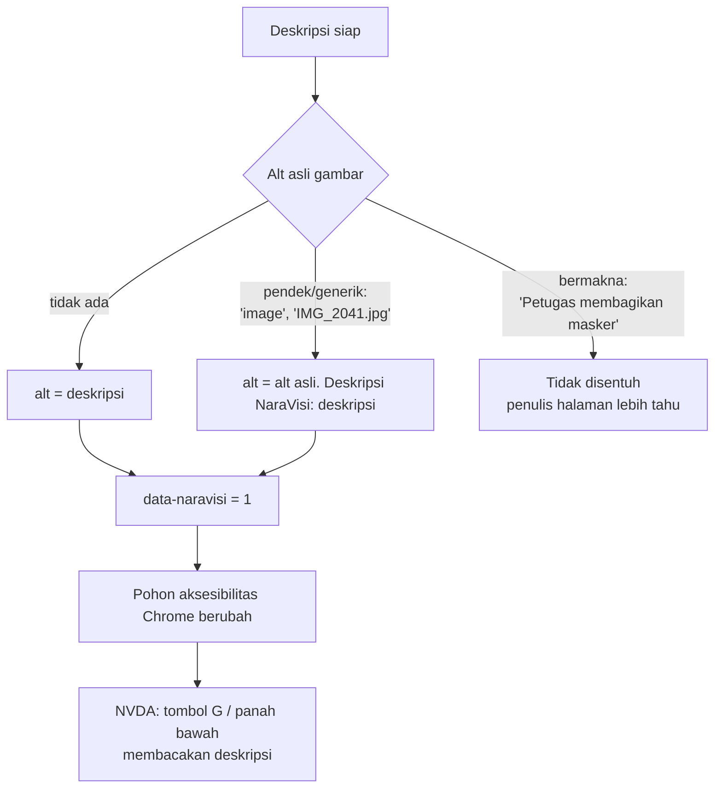

Tes e2e memeriksa ini langsung di **pohon aksesibilitas Chrome** (lewat Chrome DevTools Protocol) — yaitu data yang
sama yang diambil NVDA/JAWS dari Chrome.

### 3. Mode "Baca berurutan"

Mode ini otomatis mendeskripsikan gambar tanpa alt bermakna, **tanpa** pengguna harus membuka panel. Karena memakai kuota
dan mengirim gambar ke server (dan ke Google Gemini), mode ini **mati** sampai pengguna menyetujui dialog yang dibacakan.

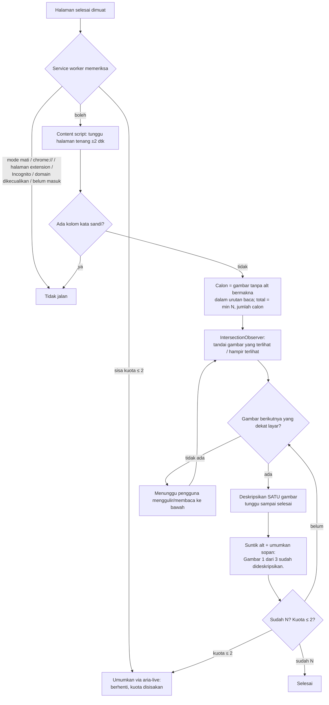

- **Satu per satu**: gambar berikutnya baru dikirim setelah yang sebelumnya selesai. Tes e2e mencatat jumlah permintaan
  yang berjalan bersamaan ke AI — nilainya selalu 1.
- **Yang terlihat dulu**: gambar di layar (dan satu layar di atas/bawahnya) diproses lebih dulu. Gambar yang jauh di bawah
  baru diproses saat pengguna sampai ke sana — NVDA menggulir halaman mengikuti kursor bacanya, jadi ini juga terjadi saat
  pengguna hanya membaca dengan panah bawah.
- **Pengumuman sopan**: progres dan alasan berhenti diumumkan lewat satu *live region* tersembunyi dengan
  `aria-live="polite"`. Pembaca layar menyampaikannya setelah selesai membaca kalimat yang sedang dibaca, jadi **tidak menyela**.
  (Sebelumnya ringkasan dibacakan dengan suara `chrome.tts` yang bisa bertabrakan dengan suara NVDA.)

### 4. Pintasan

Pintasan yang berlaku selalu dibaca dari `chrome.commands.getAll()`, bukan dari teks tetap. Bila kosong (mis. bentrok
dengan extension lain), popup dan halaman Pengaturan menyatakan "Pintasan belum diatur" dan menyediakan tombol ke
`chrome://extensions/shortcuts`. Pintasan utama tetap **Alt+Shift+K** ("Pindai gambar pada halaman ini").

### Alur manual tetap sama

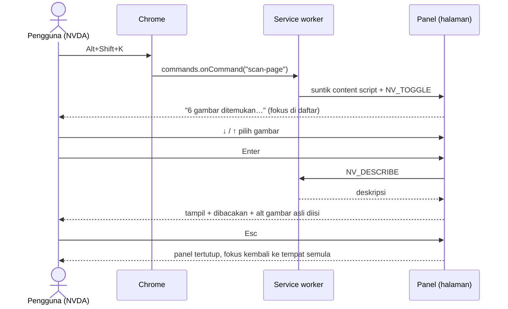

### Bukti (tes e2e)

`urutan baca = urutan DOM` · `layout grid dengan order CSS → urutan visual` · `alt asli bermakna tidak ditimpa, alt generik
digabung, tanpa alt diisi; terbaca di pohon aksesibilitas` · `baca berurutan: maks. N, satu per satu, yang terlihat dulu, lanjut
saat digulir; progres via aria-live` · `halaman dengan kolom kata sandi / domain dikecualikan → tidak jalan` ·
`ALUR MANUAL: Alt+Shift+K → panel → panah → Enter → dibacakan → Esc`.

---

## Tahap 3 — Fitur menuju 70% (11 RF tambahan → 21/30)

### Prinsip yang sama untuk setiap fitur

Setiap fitur akun, riwayat, pengaturan, dan laporan mengikuti empat aturan yang sama di backend:

1. **Validasi input** di server (bukan hanya di halaman): panjang teks, format email, pilihan yang diizinkan.
2. **Query berparameter** (`?`), tidak pernah menyambung teks pengguna ke SQL.
3. **Cek kepemilikan**: setiap query memakai `WHERE user_id = <pengguna yang login>`. Data milik orang lain
   diperlakukan seolah tidak ada (`404`), jadi orang lain bahkan tidak tahu data itu ada.
4. **Pesan galat berbahasa Indonesia** yang aman dibacakan, plus nama kolom yang salah (`details.field`) supaya halaman
   bisa memindahkan fokus keyboard ke kolom itu.

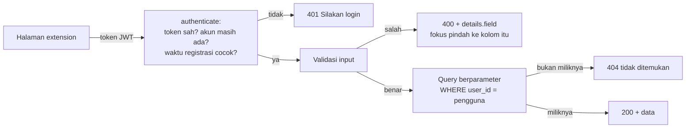

### Akun (RF-02, RF-03, RF-04)

- **Lihat profil (RF-02):** nama, email, status (Gratis/Premium/Admin), kuota hari ini, tanggal daftar.
- **Ubah profil (RF-03):** nama bebas diubah. Mengganti **email atau kata sandi wajib memasukkan kata sandi saat ini**,
  supaya orang yang sempat memakai laptop pengguna tidak bisa mengambil alih akun. Email yang sudah dipakai → pesan jelas.
- **Hapus akun permanen (RF-04):** pengguna mengetik **HAPUS** (huruf besar) dan kata sandinya. Bisa dilakukan sepenuhnya
  dengan keyboard; tidak ada dialog yang sulit dijangkau pembaca layar.

```mermaid
sequenceDiagram
    actor P as Pengguna
    participant H as Halaman Profil
    participant B as Backend
    participant DB as MySQL
    P->>H: ketik "HAPUS" + kata sandi, Enter
    H->>H: bukan "HAPUS"? → pesan + fokus ke kolom
    H->>B: DELETE /me {konfirmasi, kata_sandi}
    B->>B: cek "HAPUS" & kata sandi
    B->>DB: DELETE FROM users WHERE user_id = ?
    DB-->>DB: ON DELETE CASCADE: riwayat, laporan,<br/>pengaturan, kuota ikut terhapus;<br/>transaksi dianonimkan
    B-->>H: {dihapus: true}
    H->>H: hapus sesi di extension
    Note over B: Token lama → 401 (akunnya sudah tidak ada).<br/>Token juga membawa waktu registrasi, jadi tidak<br/>berlaku untuk akun baru yang mendapat ID sama.
```

### Riwayat (RF-14, RF-15, RF-16)

- **Daftar (RF-14):** 10 per halaman (tombol Sebelumnya/Berikutnya). Akun Gratis melihat 7 hari terakhir; yang lebih lama
  disembunyikan (bukan dihapus) dan muncul lagi setelah Premium.
- **Detail (RF-15):** `riwayat.html?id=…` menampilkan teks, **jenis gambar**, pembuat deskripsi (Google Gemini atau BLIP), waktu,
  alamat halaman & gambar. Fokus langsung di tombol **Putar ulang**, jadi cukup tekan Enter untuk mendengar lagi.
- **Hapus (RF-16):** satu per satu, atau **Hapus semua riwayat** — keduanya dengan konfirmasi. Backend hanya menghapus semua
  bila badan permintaan berisi `{"semua": true}`, untuk mencegah terhapus tanpa sengaja.

### Pengaturan (RF-17, RF-18, RF-19)

- **Bahasa (RF-18):** Indonesia atau English; dipakai untuk permintaan deskripsi berikutnya (tes e2e membuktikan AI menerima `lang=en`).
- **Pintasan (RF-18):** yang berlaku dibaca dari Chrome. Chrome hanya mengizinkan pintasan diubah di
  `chrome://extensions/shortcuts`, jadi halaman menyediakan tombol ke sana. Kombinasi yang bentrok dengan Chrome/NVDA ditolak.
- **Suara (RF-19):** kecepatan (semua pengguna — pengguna pembaca layar sangat bergantung pada kecepatan), nada & jenis suara
  (Premium), tombol **Coba suara**. Penggeser mengumumkan nilai yang mudah dipahami, mis. "1,5 kali".

### Laporan (RF-20)

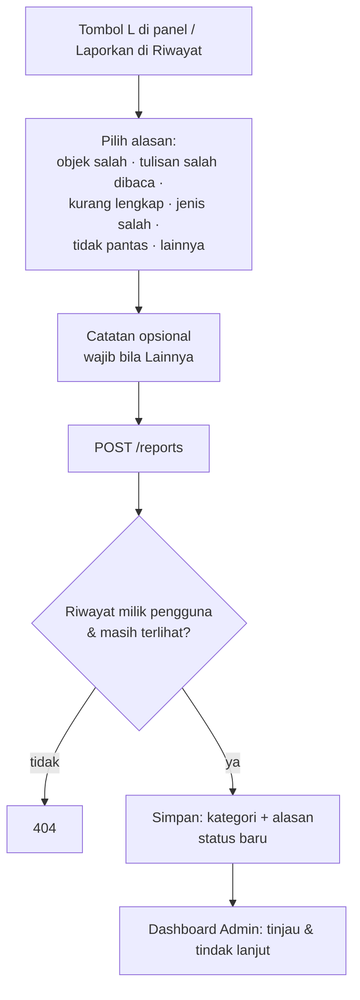

Pilihan alasan membuat laporan **bisa dihitung** (mis. "berapa persen laporan karena tulisan salah dibaca"), yang nanti berguna
untuk mengevaluasi model di Tahap 4.

### Premium (RF-23)

Halaman Premium menampilkan paket Bulanan Rp15.000 / 30 hari beserta manfaatnya (`GET /plans`, tanpa login). Pembayaran
sungguhan berada di luar target 70% (mode simulasi tetap tersedia untuk demo).

### Bukti (tes)

| RF | Backend (`npm test`) | E2E (`e2e/run.mjs`) |
|---|---|---|
| RF-02/03 | `UC-AKUN-02`, `UC-AKUN-03`, `RF-03: ubah email …` | `UC-AKUN-02`, `UC-AKUN-03`, `RF-03: ubah email …` |
| RF-04 | `UC-AKUN-04: … "HAPUS" … token dicabut`, `token akun terhapus …` | `RF-04: hapus akun permanen …` |
| RF-14..16 | `UC-RWY-02..04`, `RF-15`, `RF-16: hapus semua …` | `UC-RWY-02..04`, `RF-15: detail …`, `RF-16: hapus SEMUA …` |
| RF-17..19 | `UC-AKS-01..03`, `RF-17: pengaturan milik masing-masing …` | `UC-AKS-01..03`, `RF-18: bahasa English …`, `Coba suara` |
| RF-20 | `UC-LAP-01`, `RF-20: pilih alasan + catatan …` | `RF-20: kirim laporan dari panel`, `RF-20 dari halaman Riwayat` |
| RF-23 | `GET /plans` (premiumAdmin.test.js) | `UC-PRM-01: paket Bulanan Rp15.000 / 30 hari tampil` |

---

## Tahap 4 — Penutup 70%: verifikasi, privasi, dan dataset evaluasi

Di tahap ini tidak ada RF baru. Enam RF yang sudah ada (RF-02, RF-03, RF-04, RF-18, RF-20, RF-23) diperiksa ulang satu per
satu terhadap empat aturan di Tahap 3. Celah yang ditemukan ditutup, lalu mode Baca berurutan diuji untuk setiap kondisi
privasinya. Terakhir, dibuat dataset evaluasi sendiri untuk mengukur mutu Gemini dan BLIP dengan jujur.

### Akun: lihat, ubah, hapus

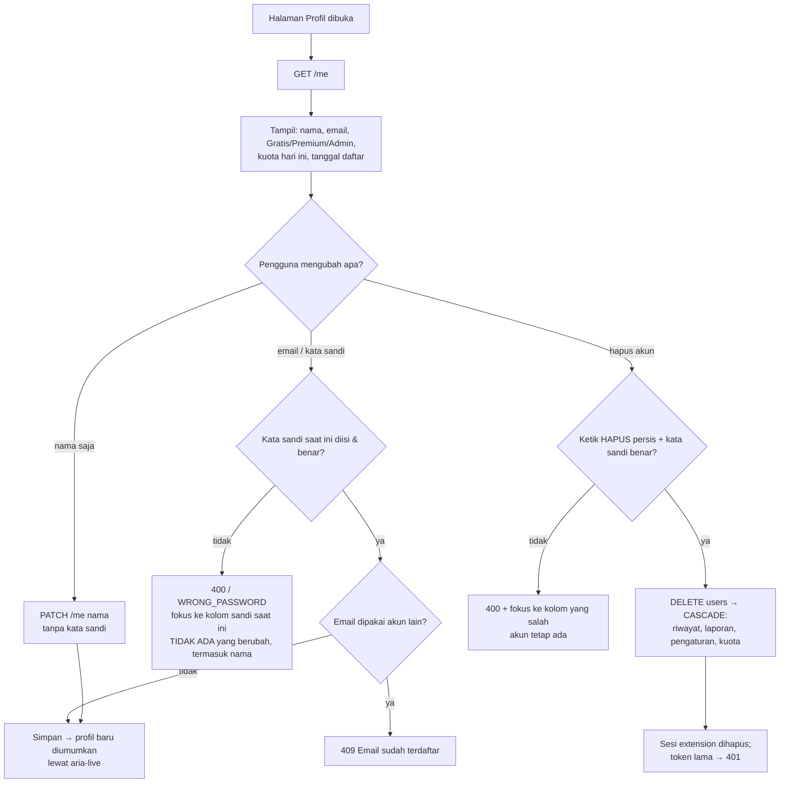

Celah yang ditutup / dibuktikan di tahap ini: input yang bukan teks (mis. objek JSON) ditolak dengan pesan Indonesia, sandi
lama yang salah tidak mengubah apa pun, dan penghapusan akun terbukti ikut menghapus laporan, pengaturan, dan kuota, sementara
data akun lain tetap utuh.

### Laporan: alasan wajib dipilih

Sebelumnya backend masih menerima teks bebas `alasan` tanpa pilihan (sisa klien lama) dan catatan sampai 1000 karakter.
Sekarang backend, panel, dan halaman Riwayat memakai aturan yang sama:

| Aturan | Backend (`reportService.js`) | Panel & Riwayat |
|---|---|---|
| Alasan wajib dipilih dari 6 pilihan | `kategori` kosong / tidak dikenal → 400 | pesan + fokus ke daftar pilihan |
| Catatan opsional, 3–500 karakter (wajib bila "Lainnya") | `CATATAN_MAKS = 500` | `maxlength="500"` + batas disebut di label |
| Hanya deskripsi milik sendiri | riwayat orang lain / tidak ada → 404, tidak ada baris tersimpan | – |

### Premium (RF-23): hanya menampilkan paket

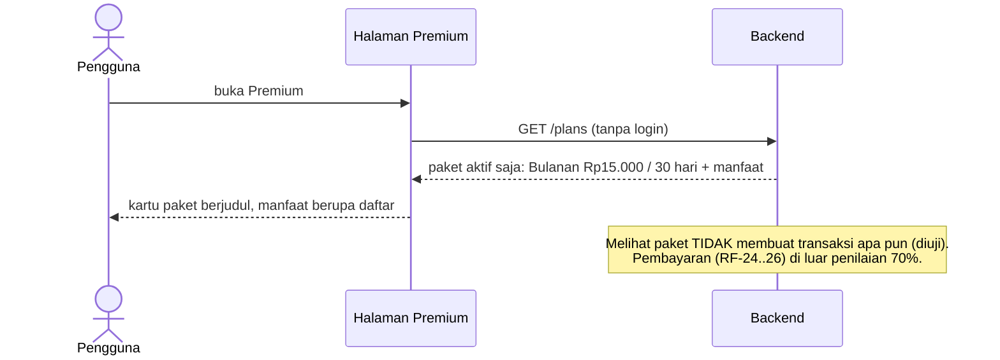

### Mode Baca berurutan: pemeriksaan privasi

Alur lengkapnya ada di Tahap 2. Yang ditambahkan di tahap ini adalah **bukti uji untuk setiap kondisi**:

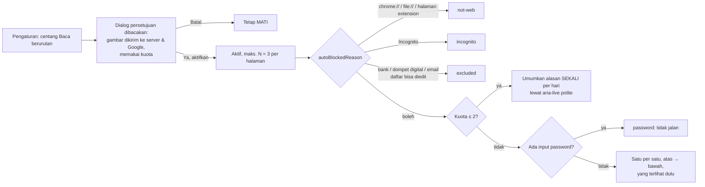

### Dataset → few-shot → evaluasi

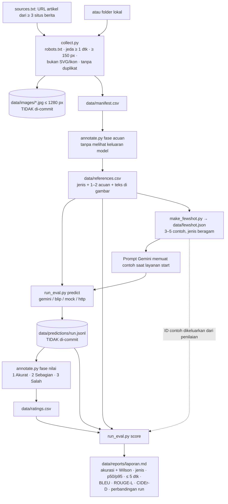

Dataset ini dipakai untuk **few-shot dan evaluasi (prompt tuning)**, **bukan** untuk melatih ulang bobot model. Gambar yang
sudah menjadi contoh few-shot otomatis tidak ikut dinilai, supaya skornya tidak terlihat lebih bagus dari kenyataan. Detail: `docs/DATASET.md`.

### Bukti (tes tahap 4)

| Bagian | Tes |
|---|---|
| RF-03/04 | `auth.test.js`: "RF-03: nama/sandi bukan teks …", "RF-04: laporan, pengaturan, dan kuota ikut terhapus …" |
| RF-18 | e2e: "RF-18: pintasan AKTIF dibaca dari chrome.commands.getAll() …", "RF-18: pintasan kosong → … tautan …" |
| RF-20 | `settingsReports.test.js`: "RF-20: catatan opsional maks. 500 karakter …", "tidak bisa melaporkan riwayat milik orang lain (404 …)" · e2e: "RF-20: catatan dibatasi 500 karakter …" |
| RF-23 | `premiumAdmin.test.js`: "RF-23: daftar paket publik …" · e2e: "RF-23: membuka daftar paket tidak membuat transaksi …" |
| Baca berurutan | e2e: "baca berurutan TIDAK jalan di chrome://, halaman extension, file://, Incognito, domain dikecualikan", "alasan kuota tidak diumumkan berulang …", ditambah skenario Tahap 2 |
| Dataset | `tests/test_eval_metrics.py` (nilai yang dihitung tangan), `test_eval_collect.py` (parser HTML, filter, robots.txt, jeda), `test_eval_pipeline.py` (predict mock → score → few-shot → prompt; alat anotasi) |

---

## Tahap 5 — Langkah 0: menuntaskan 70% (uji ulang + evaluasi model asli)

### Ide besarnya

Sebelum menambah fitur baru, semua tes dijalankan ulang dan kedua model AI diuji pada **dataset yang sama** dengan
**jawaban acuan tulisan manusia**. Hasilnya dicatat apa adanya di `docs/PENGUJIAN.md` bagian M-01, termasuk yang gagal.

### Alur evaluasi

1. **Tulis acuan** (`python -m eval.annotate`, http://127.0.0.1:8765/acuan). Manusia menulis deskripsi ideal tiap gambar
   *tanpa* melihat keluaran model, supaya acuannya tidak ikut-ikutan model. Tersimpan di `eval/data/references.csv`.
2. **Prediksi** (`python -m eval.run_eval predict --provider gemini|blip --run <nama>`). Setiap gambar dikirim ke kode
   layanan AI yang **sama dengan produksi** (tanpa cadangan, agar kegagalan terlihat). Satu baris per gambar, galat ikut
   dicatat, ke `eval/data/predictions/<nama>.jsonl`.
3. **Skor** (`python -m eval.run_eval score --runs ...`). Membandingkan prediksi dengan acuan: berapa yang berhasil,
   jenis gambar benar, waktu p50/p95, % ≤ 5 detik, BLEU/ROUGE-L/CIDEr-D. Ditulis ke `eval/data/reports/laporan.md`.
4. Angka laporan disalin ke `docs/PENGUJIAN.md` tanpa diubah.

### Temuan: jawaban Gemini terpotong (C-12)

Model Gemini versi baru "berpikir" dulu sebelum menjawab. Masalahnya, token untuk berpikir dan token untuk jawaban
diambil dari **satu jatah yang sama** (`max_output_tokens`).

```
Jatah 1024 token:  [■■■■■■■■■■■■■■■■■■■ berpikir 979 ■■■■■■■■■■■■■■■■■■■][jawab 30] → habis!
                   JSON terpotong: {"jenis": "foto", "ringkasan": "Seekor ...   → ditolak validasi

Jatah 4096 token:  [■■■■■■■■■ berpikir 1881 ■■■■■■■■■][■■■ jawab 581 ■■■][ sisa ]  → STOP, JSON utuh
```

Karena JSON tidak lengkap, validator (`GeminiCaption`) menolaknya dan pengguna mendengar "Jawaban Gemini tidak sesuai
format". Perbaikannya:

- Bawaan `GEMINI_MAX_OUTPUT_TOKENS` dinaikkan dari 1024 ke **4096** (masih bisa diatur lewat `.env`).
- Bila Gemini berhenti karena `MAX_TOKENS`, log sekarang menulis **"terpotong (MAX_TOKENS) … naikkan
  GEMINI_MAX_OUTPUT_TOKENS"**, bukan sekadar "tidak valid", sehingga penyebabnya langsung terlihat.
- Alur pengguna tidak berubah: bila Gemini tetap gagal, cadangan BLIP tetap dipakai seperti biasa.

### Hal yang perlu diingat

- Model yang berpikir lebih **lambat** (p50 ±10 dtk). RNF-04 (≤ 5 dtk) belum tercapai dengan Gemini; BLIP cepat tetapi
  deskripsinya jauh lebih miskin.
- Kuota Gemini gratis bisa habis di tengah evaluasi (429 → `MODEL_BUSY`); gambar itu tercatat sebagai galat, bukan dibuang.
- BLIP di CPU butuh RAM lega; dengan RAM bebas 1,5 GB ia gagal memuat.

### Bukti (tes)

| Bagian | Tes |
|---|---|
| Bawaan 4096 & bisa diubah lewat env | `tests/test_gemini.py`: `test_batas_token_bawaan_cukup_untuk_model_berpikir` |
| Log jelas saat terpotong | `tests/test_gemini.py`: `test_jawaban_terpotong_max_tokens_dicatat_jelas` |
| Alur manual & pintasan tidak berubah | e2e: "ALUR MANUAL: Alt+Shift+K → panel → panah → Enter → dibacakan → Esc" |

---

## Tahap 6 — Langkah 1: Premium yang aman (RF-24, RF-25, RF-26)

### Ide besarnya

Server **tidak pernah percaya begitu saja** pada data pembayaran yang datang dari luar. Harga diambil dari database
server, dan setiap kabar "sudah dibayar" diperiksa tiga kali sebelum akun dijadikan Premium.

### RF-24 — Memilih paket: harga selalu dari server

```
Extension ──POST /payments { paket_id: 1, jumlah: 1 }──▶ Backend
                                                        │  jumlah dari klien DIABAIKAN
                                                        ▼
                               SELECT harga FROM paket_premium WHERE paket_id = 1   → 15000
                                                        │
                               INSERT transaksi (order_id, jumlah = 15000, 'menunggu')
                                                        │
              mode sandbox ──▶ Snap Midtrans (gross_amount 15000)   mode simulasi ──▶ /pay/simulate/<order>
```

Klien hanya boleh memilih **paket mana**, bukan **berapa harganya**. Harga yang tercatat di tabel `transaksi` saat itu
menjadi patokan semua pengecekan berikutnya.

**Halaman bayar SIMULASI.** Bila `MIDTRANS_SERVER_KEY` kosong, server memakai halaman bayar buatan sendiri. Agar tidak
ada yang mengira itu pembayaran sungguhan, kata **SIMULASI** dipasang di semua tempat yang mungkin dibacakan NVDA:

| Tempat | Yang dibacakan |
|---|---|
| Judul tab (dibaca saat tab terbuka) | "SIMULASI pembayaran — NaraVisi" |
| Judul halaman (`h1`, tombol H di NVDA) | "SIMULASI — pembayaran Premium (bukan pembayaran sungguhan)" |
| Tiap tombol + keterangannya (`aria-describedby`) | "SIMULASI: bayar berhasil … Ini halaman SIMULASI … Tidak ada uang yang ditagih" |
| Hasil (`role="status"`) | "SIMULASI: Pembayaran berhasil" |
| Tombol beli di halaman Premium extension | "Beli Premium Bulanan" + keterangan "SIMULASI: pembayaran demo, tidak ada uang yang ditagih" |
| Pesan setelah klik beli (`aria-live`) | "Halaman pembayaran SIMULASI dibuka di tab baru. Tidak ada uang yang ditagih." |

Pita merah "SIMULASI" di atas halaman diberi `aria-hidden` karena hanya untuk mata; NVDA sudah mendengar kata yang sama
dari judulnya, jadi tidak diucapkan dua kali.

### RF-25 — Aktivasi: tiga lapis pemeriksaan webhook

Midtrans memanggil `POST /api/v1/payments/notification` saat pembayaran berubah. Siapa pun bisa memanggil alamat itu,
jadi isinya diperiksa berlapis:

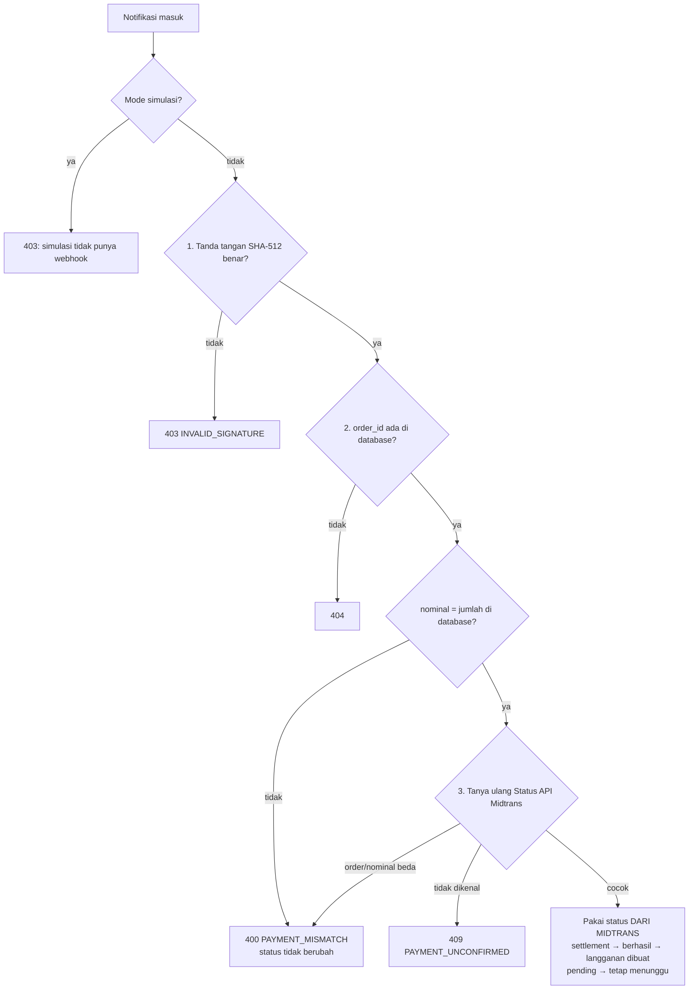

1. **Tanda tangan** membuktikan pengirimnya memegang server key. Dibandingkan dengan `timingSafeEqual` agar lama
   pengecekan tidak membocorkan berapa huruf yang sudah benar.
2. **Cocokkan dengan database.** Order harus ada, dan nominalnya harus sama dengan harga yang dicatat saat order dibuat.
   Nominal dibandingkan dalam sen (`"15000.00"` dari Midtrans = `15000` di database). Ini menangkap pembayaran Rp1.000
   untuk paket Rp15.000 → **"nominal dimanipulasi ditolak"**.
3. **Konfirmasi ulang ke Status API.** Server bertanya langsung ke Midtrans, "order ini statusnya apa?". Yang dipakai
   adalah **jawaban Midtrans**, bukan isi notifikasi. Jawaban itu juga dicocokkan lagi order & nominalnya.

Hanya bila ketiganya lolos, status berubah. Status yang dipakai tetap status SRS (`menunggu`, `berhasil`, `gagal`,
`kedaluwarsa`); penolakan tidak menambah status baru, transaksinya tetap `menunggu`.

Galat 4xx/5xx membuat Midtrans mengirim ulang notifikasi nanti, jadi gangguan sementara (mis. Status API tidak bisa
dihubungi → 502) tidak menghilangkan pembayaran yang sah.

**Tanpa webhook (localhost).** Tombol "Cek status pembayaran" bertanya ke Status API dengan aturan pencocokan yang sama;
bila nominalnya beda, status tidak diubah.

**Mode simulasi** melewati langkah 3 karena tidak ada Midtrans: tombol di halaman SIMULASI langsung memanggil
`applyStatus`, yang tetap idempoten (dibayar dua kali tidak menambah masa aktif).

### RF-26 — Status & masa aktif

Tidak berubah: Premium dihitung dari tabel `langganan` (ada langganan yang `tanggal_berakhir ≥ hari ini` WITA).
Perpanjangan disambung setelah langganan aktif terakhir. Halaman Premium menampilkan "Status" dan "Berlaku hingga" dalam
daftar definisi (`dl`) yang dibaca NVDA sebagai pasangan label–nilai.

### Server key

`MIDTRANS_SERVER_KEY` hanya dibaca dari `backend/.env` (tidak masuk git). Extension tidak pernah tahu kunci itu; ia
hanya menerima `redirect_url` dan `mode_pembayaran`. Tes memastikan kunci tidak muncul di respons API mana pun.

### Bukti (tes)

| Aturan | Tes |
|---|---|
| Nominal dimanipulasi ditolak | `premiumAdmin.test.js`: "RF-25: nominal dimanipulasi ditolak (tanda tangan sah, nominal ≠ database) → tetap Gratis" |
| Status API beda nominal | "RF-25: nominal notifikasi cocok tetapi Status API Midtrans berbeda → ditolak" |
| Status API masih pending | "RF-25: notifikasi \"settlement\" tetapi Status API masih pending → tidak diaktifkan" |
| Tidak dikenal Midtrans | "RF-25: transaksi tidak dikenal Status API Midtrans → 409, tidak diaktifkan" |
| Order tak ada | "RF-25: order_id yang tidak ada di database → 404" |
| Cek status manual | "RF-25: cek status manual juga menolak nominal Status API yang berbeda" |
| Harga dari server | "harga selalu dari database server: jumlah/harga kiriman klien diabaikan" |
| Server key | "server key Midtrans tidak pernah ikut dalam respons API" |
| Label SIMULASI | `premiumAdmin.test.js` UC-PRM-02/03 · e2e: "UC-PRM-02/03 + RF-24: beli → halaman bayar SIMULASI berlabel jelas & lolos audit → bayar → akun Premium" |
| Alur manual tetap | e2e: "ALUR MANUAL: Alt+Shift+K → panel → panah → Enter → dibacakan → Esc" |

---

## Tahap 7 — Langkah 2: Admin yang aman (RF-21, RF-22, RF-27..RF-30)

### Ide besarnya

Dashboard Admin hanyalah tampilan. **Semua keputusan diambil di server**: siapa yang boleh, apa yang boleh diubah, dan
apakah datanya tetap rapi. Ada tiga aturan baru:

1. Setiap rute `/api/v1/admin/*` memeriksa peran di server pada **setiap** permintaan.
2. Sistem **selalu punya minimal satu Admin aktif**.
3. Menghapus pengguna harus **disengaja** (ketik email pengguna itu) dan **utuh** (semua bagian terhapus bersama, atau
   tidak ada sama sekali).

### Aturan 1 — Peran dicek di server, dibaca dari database

```
Permintaan ──▶ dispatch: rute ber-auth 'admin'?
                 │
                 ├─ tanpa token / token rusak ─────────────▶ 401
                 ├─ token sah → SELECT peran, status_akun FROM users WHERE user_id = sub
                 │     ├─ akun nonaktif ───────────────────▶ 403 ACCOUNT_DISABLED
                 │     └─ peran ≠ 'admin' ─────────────────▶ 403 FORBIDDEN
                 └─ Admin aktif ──▶ handler
```

Peran **tidak** diambil dari isi token, melainkan dari database setiap kali. Akibatnya, Admin yang baru saja diturunkan
langsung ditolak pada permintaan berikutnya walaupun tokennya belum kedaluwarsa. Tes membaca seluruh tabel rute dan
memastikan semua rute `/api/v1/admin` bertanda `auth: 'admin'`. Setelah itu setiap rute dipanggil sebagai pengguna biasa
(harus 403) dan tanpa login (harus 401), dan dipastikan tidak ada data yang berubah. Bila nanti ada rute Admin baru yang
lupa diberi tanda, tes ini langsung gagal.

### Aturan 2 — Admin aktif terakhir dilindungi (RF-29, RF-30)

"Admin aktif" artinya `peran = 'admin'` **dan** `status_akun = 'aktif'`. Tiga tindakan dapat menghilangkan Admin aktif:
**menghapus**, **menurunkan** peran ke pengguna, dan **menonaktifkan**. Ketiganya ditolak bila sasarannya Admin aktif
terakhir:

```
Mulai transaksi
  SELECT user_id FROM users WHERE peran='admin' AND status_akun='aktif'  (MySQL: FOR UPDATE → baris Admin dikunci)
  sasaran ada di daftar DAN daftar hanya berisi 1?  ──ya──▶ ROLLBACK, 409 LAST_ADMIN
                                                  └─tidak─▶ ubah / hapus, COMMIT
```

**Kenapa di dalam transaksi?** Misalkan hanya ada dua Admin, A dan B, dan keduanya saling menurunkan pada detik yang
sama. Bila pemeriksaan dilakukan di luar transaksi, keduanya melihat "ada 2 Admin", keduanya lolos, dan akhirnya tidak
ada Admin sama sekali. Di dalam transaksi pemeriksaan berjalan bergiliran: di MySQL baris Admin dikunci dengan
`FOR UPDATE`, sedangkan SQLite menjalankan transaksi satu per satu. Hasilnya, yang kedua melihat "tinggal 1" dan ditolak.

Aturan lama tetap berlaku: Admin tidak bisa menghapus, menurunkan, atau menonaktifkan **dirinya sendiri** (400). Mengubah
nama atau email Admin terakhir tetap boleh.

Di dashboard, pesan `LAST_ADMIN` tampil di kotak galat formulir (`role="alert"`), sehingga NVDA langsung membacakannya.

### Aturan 3 — Hapus pengguna: disengaja dan utuh (RF-30)

**Disengaja.** Dialog "Hapus pengguna?" berisi kolom **"Ketik email pengguna untuk konfirmasi"**:

```
Tombol "Hapus Dewi" ──▶ dialog terbuka, fokus di kolom email
                         NVDA: "Hapus pengguna? Akun Dewi (dewi@uji.id) … akan dihapus permanen …
                                Ketik email pengguna untuk konfirmasi, edit, Ketik dewi@uji.id lalu tekan Hapus permanen."
Ketik email salah + Enter ──▶ dialog tetap terbuka, kolom diberi aria-invalid, fokus kembali ke kolom
                              NVDA (role="alert"): "Email tidak cocok. Ketik dewi@uji.id untuk menghapus."
Ketik email benar + Enter ──▶ DELETE /admin/users/:id { konfirmasi_email } ──▶ dialog tertutup
                              NVDA: "Pengguna Dewi berhasil dihapus."
Batal / Esc ──▶ "Penghapusan dibatalkan."
```

Pemeriksaan di browser hanya untuk kenyamanan. **Server memeriksa ulang**: bila `konfirmasi_email` kosong, salah,
atau bukan teks, permintaan ditolak dengan `400 VALIDATION_ERROR` (`field: konfirmasi_email`) dan tidak ada yang
terhapus. Huruf besar/kecil dan spasi di tepi diabaikan.

**Utuh.** Semua langkah penghapusan berjalan di **satu transaksi database**:

```
BEGIN
  1. cari pengguna                         → tidak ada: 404
  2. cocokkan konfirmasi_email             → salah: 400
  3. cek Admin aktif terakhir              → ya: 409
  4. DELETE riwayat_deskripsi milik pengguna   (laporan atas riwayat itu ikut terhapus)
  5. UPDATE transaksi SET user_id = NULL       (bukti pembayaran disimpan tanpa identitas — ADR-13)
  6. UPDATE laporan SET admin_id = NULL        (laporan yang pernah ia tinjau tetap ada)
  7. DELETE users                              (pengaturan, kuota, langganan ikut terhapus — ON DELETE CASCADE)
COMMIT   ← hanya bila 1–7 semua berhasil; galat di langkah mana pun → ROLLBACK, data kembali seperti semula
```

Bila server mati atau database galat di langkah 7, langkah 4–6 ikut dibatalkan. Tidak akan ada pengguna yang riwayatnya
sudah hilang tetapi akunnya masih ada, atau transaksinya sudah anonim tetapi akunnya masih ada. Tes membuktikannya
dengan membuat langkah 7 gagal dengan sengaja, lalu memeriksa bahwa riwayat dan transaksi tidak berubah. Respons
berhasil menyebut jumlahnya: `{ dihapus: true, riwayat_dihapus, transaksi_dianonimkan }`.

### RF-21 / RF-22 — Laporan: status tetap sesuai SRS

Tidak ada status baru. Status laporan tetap **`baru`** atau **`ditinjau`**, dan nilai lain (`selesai`, `ditolak`, …)
ditolak dengan 400. Menandai `ditinjau` wajib mengisi tindak lanjut, dan peninjau serta waktunya dicatat. Bila Admin
peninjau kemudian dihapus, laporannya tetap ada dan kolom peninjau dikosongkan.

### Bukti (tes)

| Aturan | Tes |
|---|---|
| Semua rute Admin dicek di server | `premiumAdmin.test.js`: "RNF-10: SETIAP rute /api/v1/admin dicek peran di server (pengguna → 403, tanpa login → 401)" |
| Peran dari database | "RNF-10: peran dibaca dari database, bukan dari token — Admin yang diturunkan langsung ditolak (403)" |
| Konfirmasi email | "RF-30: hapus wajib konfirmasi dengan mengetik email pengguna (kosong/salah → 400, data tetap ada)" |
| Admin terakhir | "RF-30: Admin aktif terakhir tidak bisa dihapus, diturunkan, atau dinonaktifkan (409 LAST_ADMIN)" |
| Balapan dua Admin | "saling menurunkan / saling menonaktifkan / saling menghapus → satu berhasil, satu LAST_ADMIN" |
| Satu transaksi | "RF-30: hapus dalam SATU transaksi — bila langkah terakhir gagal, riwayat & transaksi tidak berubah" |
| Anonimisasi | "UC-ADM-04: hapus pengguna → riwayat terhapus, transaksi tetap tanpa identitas (ADR-13)" |
| Status laporan SRS | "RF-22: status laporan hanya \"baru\" atau \"ditinjau\" sesuai SRS; status lain ditolak" |
| Dashboard & NVDA | e2e: "RF-30: hapus tanpa mengetik email yang benar ditolak; fokus kembali ke kolom, pesan dibacakan" (+ audit aksesibilitas dialog) · "UC-ADM-04: hapus pengguna dengan konfirmasi (ketik email)" |
| Alur manual tetap | e2e: "ALUR MANUAL: Alt+Shift+K → panel → panah → Enter → dibacakan → Esc" |

---

## Tahap 8 — Langkah 3: Bukti RNF (kinerja, aksesibilitas, keamanan)

### Ide besarnya

Kebutuhan non-fungsional ("cepat", "bisa dipakai NVDA", "aman") hanya bisa diklaim kalau ada **bukti yang bisa diulang**.
Setiap RNF di `docs/PENGUJIAN.md` bagian 3 sekarang menunjuk ke alat yang menghasilkan angkanya, perintah untuk
menjalankannya ulang, dan hasilnya apa adanya, termasuk yang belum tercapai (RNF-04 dengan Gemini tetap ❌). Hal yang
hanya bisa dinilai manusia (NVDA, Midtrans Sandbox, MySQL asli, pengguna tunanetra) ditulis sebagai langkah uji
dengan **kolom hasil kosong**.

### Alur pengumpulan bukti

```
           ┌─ npm test (backend) ──────────▶ 121 tes + cakupan baris 94%
           ├─ pytest (ai-service) ─────────▶ 85 tes
 Bukti ────┼─ npm test (e2e) ──────────────▶ 113 skenario + axe-core di 15 tampilan  ─▶ RNF-02/03
           ├─ bench.js ────────────────────▶ p50/p95 per endpoint                     ─▶ RNF-05
           ├─ run_eval (Langkah 0) ────────▶ p50/p95 model AI                         ─▶ RNF-04
           ├─ npm audit / pip-audit ───────▶ kerentanan dependensi
           └─ pindai_rahasia.py ───────────▶ kunci di berkas & riwayat git
                                   │
                                   ▼
                    docs/PENGUJIAN.md (angka disalin apa adanya)
```

### p50 dan p95 — kenapa dua angka?

Setiap endpoint dipanggil 200 kali lalu waktunya diurutkan. **p50** adalah waktu di urutan tengah (separuh permintaan
lebih cepat dari ini), sedangkan **p95** adalah waktu yang dilampaui hanya oleh 5% permintaan paling lambat. Rata-rata
bisa menyembunyikan permintaan yang sesekali sangat lambat; p95 menunjukkannya. Target RNF-05 (≤ 2 detik) dibandingkan
dengan p95, bukan rata-rata.

### Audit aksesibilitas: dua lapis

```
a11yAudit(halaman)
  ├─ basicAudit : label, nama tombol, alt, satu h1, lang        (aturan sederhana buatan sendiri)
  └─ axeAudit   : axe-core, aturan WCAG 2.0/2.1/2.2 A & AA      (disuntik lewat DevTools Protocol,
                                                                  jadi tetap jalan di halaman extension ber-CSP)
  → daftar masalah; tes gagal bila tidak kosong
```

axe-core langsung menemukan satu masalah yang lolos dari pemeriksaan sendiri, yaitu WCAG 2.5.3 *Label in Name* di daftar
gambar panel. Pengguna perintah suara mengucapkan apa yang **terlihat** ("klik Gambar 1 dari 5"), jadi teks yang terlihat
harus ada di nama aksesibelnya. Sebelumnya judul dan keterangan menempel tanpa spasi ("…dari 5teks alternatif…"). Sekarang
diberi satu spasi. Tampilan tidak berubah karena keduanya elemen blok, dan `aria-label` yang dibacakan NVDA juga sama
persis. Alur manual Alt+Shift+K tidak tersentuh.

### Audit dependensi: perbaiki yang bisa, jelaskan yang tidak

1. **npm audit**: dua temuan di backend (`body-parser`, `qs`) diperbaiki tanpa mengubah kode. Temuan `sharp` di e2e
   (alat uji, tidak dikirim ke pengguna) di-upgrade ke 0.35.5.
2. **pip-audit**: dijalankan dari venv terpisah terhadap paket yang terpasang di venv layanan. Paket yang punya versi
   perbaikan kompatibel di-upgrade, lalu batas minimumnya ditulis di `requirements.txt`. FastAPI ikut naik (0.115 → 0.162)
   karena starlette lama terkunci olehnya.
3. **transformers** tidak di-upgrade. Perbaikannya ada di versi 5, yang belum diuji dengan BLIP/MarianMT. Semua temuannya
   hanya terpicu saat memuat repo model milik penyerang, sedangkan layanan hanya memuat dua model tetap dari `.env`.
   Risiko ini dicatat sebagai **diterima** beserta mitigasinya, tidak disembunyikan.

### Pindai rahasia

`scripts/pindai_rahasia.py` (Python standar, tanpa dependensi) memeriksa tiga hal:

```
git ls-files           → setiap baris berkas yang dilacak sekarang
git log --all -p       → setiap baris yang PERNAH ditambahkan (kunci yang sudah dihapus tetap ada di riwayat!)
git log --name-status  → berkas .env yang pernah di-commit + ukurannya
```

Polanya mencakup kunci Google/Gemini (`AIza…`), kunci Midtrans (`Mid-server-…`), private key, token, JWT, dan penugasan
`*_SECRET=`/`*_KEY=` berisi nilai harfiah. Placeholder seperti `ganti-dengan-…` diabaikan. Nilai yang ditemukan **tidak
pernah dicetak**, hanya jenis, lokasi, dan panjangnya, agar laporan pemindaian tidak ikut membocorkan kunci. Skrip keluar
dengan kode 1 bila ada temuan, jadi bisa dipakai sebagai gerbang sebelum commit/push.

### Hal yang perlu diingat

- Angka bench sekitar 15 ms di mesin ini didominasi biaya koneksi lokal (bahkan `GET /plans` yang tanpa basis data
  juga sekitar 15 ms), bukan kerja endpoint. Yang penting: jauh di bawah 2 detik.
- Audit otomatis 0 pelanggaran **bukan** berarti sudah nyaman dipakai NVDA. M-03 dan M-05 tetap wajib dijalankan manusia.

---

## Tahap 9 — Langkah 4: penutup 100%

### Ide besarnya

Tidak ada fitur baru. Langkah ini mengemas hasil kerja supaya **orang lain bisa memasang, menjalankan, dan memeriksa**
NaraVisi tanpa bertanya, dan supaya perbedaan dengan SRS/SDD v1.1 tercatat jelas.

### Alur rilis 1.1.0

```
1. versi         extension/manifest.json  1.0.0 → 1.1.0
2. dokumen       README (30/30 RF, instal + Gemini, keamanan, privasi, keterbatasan)
                 docs/PERUBAHAN_SRS_SDD.md (apa yang berbeda dari SRS/SDD v1.1 dan kenapa)
                 docs/KEPUTUSAN.md ADR-23..ADR-27 · docs/ALUR.md (gambaran besar + daftar isi)
3. gerbang       semua tes lulus (backend, layanan AI, e2e + axe-core)
                 python -I scripts/pindai_rahasia.py  → 0 temuan
4. paket         python -I scripts/paket_extension.py → dist/naravisi-extension-1.1.0.zip
```

### Kenapa ZIP dibuat dengan skrip, bukan "Send to → Compressed folder"?

Chrome Web Store mensyaratkan `manifest.json` berada **di akar** ZIP. Kalau folder `extension/` yang dizip, manifest
ikut masuk ke subfolder. `Compress-Archive` bawaan Windows PowerShell 5.1 juga menulis jalur dengan `\`, yang ditolak.
`scripts/paket_extension.py` menulis jalur dengan `/` dan menaruh isi `extension/` di akar. Setelah itu ia membuka ZIP-nya
lagi untuk memeriksa bahwa setiap berkas yang dirujuk manifest (service worker, popup, ikon, halaman Pengaturan) memang ada.
Terakhir ia mencetak versi, jumlah berkas, dan SHA-256 agar paket yang dibagikan bisa dicocokkan. Folder `dist/`
masuk `.gitignore`, karena paket selalu bisa dibuat ulang dari kode.

### Yang masih harus dikerjakan manusia

| Uji | Kenapa tidak bisa otomatis | Tempat mencatat |
|---|---|---|
| M-03 NVDA | butuh pembaca layar & suara sungguhan | `docs/PENGUJIAN.md` bagian 4 |
| M-04 Midtrans Sandbox | butuh akun & Server Key Sandbox | idem |
| M-05 pengguna tunanetra | menilai kemudahan, bukan kebenaran | idem |
| M-06 MySQL asli | butuh server MySQL di laptop | idem |
| Penilaian akurasi M-01 | butuh mata manusia (fase "nilai" `eval.annotate`) | `ai-service/eval` |

---

## Tahap 10 — Online Langkah 1: mode production

### Ide besarnya

NaraVisi kini punya dua mode, dipilih dengan `APP_ENV` di `backend/.env` dan `ai-service/.env`:

| | development (bawaan) | production |
|---|---|---|
| Dipakai oleh | Anda sendiri di laptop, tes otomatis | orang lain lewat internet |
| Kunci kosong | boleh (memakai bawaan pengembangan) | **server menolak start** |
| Pembayaran | halaman SIMULASI lokal bila tanpa kunci Midtrans | selalu Midtrans **Sandbox**; halaman simulasi tidak ada |
| Provider AI | gemini / blip / mock | wajib Gemini + cadangan BLIP; mock ditolak |

Alasannya sederhana: lebih baik server **tidak menyala** daripada menyala dengan kunci contoh yang ada di repo publik
(siapa pun bisa memalsukan token) atau dengan halaman "bayar berhasil" palsu yang bisa diklik siapa saja.

### Pemeriksaan saat start (backend)

1. `server.js` memanggil `loadConfig()` (`backend/src/config.js`).
2. `appEnvFrom` membaca `APP_ENV` (kosong = development; nilai lain selain development/production ditolak).
3. Bila production, `productionProblems` memeriksa **semua** syarat sekaligus:
   `JWT_SECRET` ≥ 32 karakter, `PUBLIC_URL` diawali `https://`, `ALLOWED_ORIGINS` terisi,
   `MIDTRANS_SERVER_KEY` terisi, dan `MIDTRANS_IS_PRODUCTION` bukan `true`.
4. Ada masalah → `ConfigError` berisi daftar. `server.js` mencetak daftar itu dengan kalimat biasa, tanpa jejak
   tumpukan, lalu keluar dengan kode 1. Contoh:

```
NaraVisi tidak dapat dijalankan (APP_ENV=production).
Konfigurasi production belum lengkap:
  - JWT_SECRET kosong — isi teks acak minimal 32 karakter.
  - PUBLIC_URL harus diawali https:// (didapat "http://localhost:3000").
Perbaiki berkas backend/.env lalu jalankan ulang. Lihat backend/.env.example.
```

5. `routes.js`: di production, `simulationRoutes` tidak ikut didaftarkan, jadi `/pay/simulate/…` dijawab 404
   seperti alamat yang tidak ada. (Lapis kedua yang sudah ada sejak Tahap 6: `paymentService.simulationInfo` menolak
   bila kunci Midtrans terisi.)

### Pemeriksaan saat start (ai-service)

`load_settings` (`ai-service/app/config.py`) memanggil `production_problems`: `CAPTION_PROVIDER` harus `gemini`,
`GEMINI_API_KEY` dan `GEMINI_MODEL` terisi, `FALLBACK_PROVIDER` harus `blip`. Gagal → `main.py` mengubahnya menjadi
pesan singkat (`SystemExit`) tanpa *traceback*. `GEMINI_API_KEY` diperiksa di sini, bukan di backend, karena kunci itu
memang hanya disimpan di `ai-service/.env` dan backend tidak pernah memegangnya.

### Kuota Gemini habis → BLIP, diumumkan dengan sopan

1. Gemini menjawab 429 → `gemini.py` `_call` mengubahnya menjadi `MODEL_BUSY`.
2. `CaptionRouter.describe` (`service.py`) melihat kode itu ada di `FALLBACK_CODES` → memanggil BLIP, menandai
   `fallback = true`.
3. Backend meneruskan `fallback` apa adanya (`descriptionService.describe`).
4. Panel (`content.js` `describeCurrent`) tetap membacakan deskripsinya, lalu status (live region sopan) menambahkan:
   "Layanan AI utama sedang sibuk, jadi deskripsi ini dibuat oleh model cadangan dan mungkin lebih singkat."
   Tidak ada kata "429", "Gemini", atau kode galat yang sampai ke pengguna.
5. Bila BLIP juga belum siap, pengguna mendengar pesan yang sudah ada: "Layanan AI sedang sibuk atau kuotanya habis.
   Coba lagi beberapa saat lagi." dan kuotanya dikembalikan.

### Teks "uji coba / simulasi / demo / tiruan"

Di production tidak ada satu pun yang tampil, karena halaman dan label SIMULASI hanya muncul dalam mode simulasi, dan
mode simulasi tidak mungkin terjadi di production. Di development label SIMULASI **sengaja tetap ada** (RF-24: pengguna
harus tahu tidak ada uang yang ditagih). Kata "demo" dan "uji" yang tersisa di teks development diganti dengan
"pengembangan".

### Bukti (tes)

| Tes | Yang dibuktikan |
|---|---|
| `backend/test/production.test.js` (16) | semua masalah dilaporkan sekaligus; tiap variabel kosong disebut namanya; JWT pendek, `http://`, Midtrans produksi ditolak; `node src/server.js` keluar kode 1 dengan pesan jelas tanpa stack trace; `/pay/simulate` 404 di production dan tetap ada di development |
| `ai-service/tests/test_production.py` (8) | tanpa kunci ditolak; mock & tanpa cadangan ditolak; `import app.main` keluar kode 1 tanpa *Traceback* |
| e2e "gambar data: URL … model cadangan diumumkan sopan" | status memuat kalimat cadangan, tanpa istilah teknis; deskripsi tetap dibacakan |

---

## Tahap 11 — Online Langkah 2: dari laptop lewat Cloudflare Tunnel

### Ide besarnya

Laptop menjadi server. `cloudflared` membuka sambungan **keluar** dari laptop ke Cloudflare, lalu Cloudflare memberi
alamat `https://<acak>.trycloudflare.com`. Permintaan ke alamat itu diteruskan ke `http://localhost:3000` (backend).
Karena sambungannya keluar, tidak perlu membuka port di router dan tidak perlu IP publik. HTTPS (RNF-07) disediakan
Cloudflare.

### Urutan `scripts/start-online.ps1`

| # | Langkah | Kenapa urutannya begini |
|---|---|---|
| 0 | periksa `.venv`, `.env`, `node_modules`, cloudflared, port 3000/8000 kosong | gagal cepat dengan pesan jelas |
| 1 | MySQL (service Windows → Laragon → XAMPP → `-MysqldPath`) bila `DB_DRIVER=mysql` | backend butuh database saat start |
| 2 | layanan AI, tunggu `/health` | backend memeriksa AI di `/health` |
| 3 | cloudflared; alamat https dibaca dari log | alamat baru diketahui setelah tunnel terbuka |
| 4 | backend dengan `APP_ENV` & `PUBLIC_URL` dari skrip | `PUBLIC_URL` dipakai saat start (halaman kembali Midtrans) dan wajib https di production |
| 5 | cek `<alamat>/api/v1/health` dari internet, cetak alamat, salin ke clipboard | memastikan alamat benar-benar bisa dijangkau |

Rencana awal menyebut "backend lalu cloudflared". Urutannya dibalik karena backend membaca `PUBLIC_URL` sekali saat
start, sedangkan alamat tunnel baru diketahui setelah cloudflared jalan. Tunnel yang terbuka sebelum backend siap
hanya menjawab 502 selama beberapa detik.

### `PUBLIC_URL` otomatis tanpa mengubah `.env`

Skrip menjalankan backend dengan `$env:PUBLIC_URL='https://…'; npm start`. `node --env-file` tidak menimpa variabel
yang sudah ada di proses, jadi nilai dari skrip yang dipakai, sedangkan `backend/.env` tetap utuh. Cara yang sama
dipakai untuk `APP_ENV` di backend dan layanan AI.

### Batasan

- Alamat berganti setiap kali dijalankan → pengguna memasukkan alamat baru di Pengaturan extension.
- Laptop harus menyala dan terhubung internet.
- Quick Tunnel ditujukan untuk uji coba: tanpa jaminan ketersediaan, dengan batas permintaan bersamaan.

Rincian, pemasangan cloudflared, dan keamanan: `deploy/CLOUDFLARE_TUNNEL.md`.

### Bukti

Skrip lolos pemeriksa sintaks PowerShell (`Parser.ParseFile`, 0 galat) dan hanya memakai karakter ASCII (aman untuk
Windows PowerShell 5.1). Uji jalan sungguhan (tunnel terbuka, alamat terbaca, backend terjangkau dari internet) harus
dilakukan manusia setelah cloudflared terpasang. Langkahnya ada di `deploy/CLOUDFLARE_TUNNEL.md` bagian 3.

---

## Tahap 12 — Online Langkah 3: server Oracle Cloud Always Free

### Ide besarnya

Satu VM ARM64 gratis menjalankan semua komponen sebagai container Docker. Hanya **nginx** yang membuka port ke
internet. Ia memegang sertifikat HTTPS dan meneruskan permintaan ke backend di jaringan internal Docker.

| Layanan (`deploy/docker-compose.prod.yml`) | Tugas | Port ke internet |
|---|---|---|
| `nginx` | HTTPS (Let's Encrypt), alihkan http → https, batas body 10 MB | **80, 443** |
| `backend` | REST API + Dashboard Admin; saat start menjalankan `setup-db.js` (idempoten) | – |
| `ai-service` | Gemini + cadangan BLIP; model disimpan di volume `ai-models` | – |
| `mysql` | basis data (volume `mysql-data`) | – |
| `certbot` | perpanjang sertifikat tiap 12 jam | – |
| `duckdns` | jaga nama DuckDNS menunjuk IP VM (tiap 5 menit) | – |
| `backup` | `mysqldump` harian ke `deploy/backups/`, simpan 7 hari | – |

### Sertifikat pertama: masalah ayam dan telur

nginx tidak bisa menyala di port 443 tanpa sertifikat, sedangkan Let's Encrypt butuh nginx untuk memverifikasi domain
lewat port 80. `deploy/nginx/start-nginx.sh` memecahkannya: bila berkas sertifikat **belum ada**, nginx memakai
`http-only.conf.template` (hanya `/.well-known/acme-challenge/` dan `/healthz`). Setelah `certbot certonly` berhasil,
`docker compose restart nginx` membuat skrip memilih `https.conf.template`.

### Perbaikan keamanan yang ikut: `TRUST_PROXY`

Di belakang proxy (nginx di sini, cloudflared di Tahap 11), backend melihat semua permintaan datang dari **satu** IP,
yaitu IP proxy. Batas "10 login gagal → dikunci 15 menit" (per email + IP) jadi praktis per email saja, sehingga
siapa pun bisa mengunci akun orang lain. `TRUST_PROXY=1` (`backend/src/config.js` `trustProxyFrom`, `app.js`) membuat
Express memakai IP asli dari `X-Forwarded-For` yang ditambahkan proxy. Nilai ini diisi otomatis oleh
`docker-compose.prod.yml` dan `start-online.ps1`. Tanpa proxy dibiarkan kosong, karena `X-Forwarded-For` dari klien
bisa dipalsukan.

### Firewall dua lapis

1. **Security List** di konsol Oracle: ingress hanya 22, 80, 443.
2. **iptables** di VM (`deploy/oracle/firewall.sh`): sisipkan izin 80/443 sebelum aturan REJECT bawaan image Ubuntu
   Oracle, lalu simpan permanen.

Ditambah lapis ketiga yang paling penting: backend, ai-service, dan MySQL **tidak punya `ports:`**, jadi tidak ada
yang mendengarkan di antarmuka publik VM.

### Bukti

| Tes / pemeriksaan | Yang dibuktikan |
|---|---|
| `backend/test/production.test.js` "TRUST_PROXY" (3) | IP penyerang dikunci, pemilik akun dari IP lain tetap bisa masuk; tanpa `TRUST_PROXY`, `X-Forwarded-For` diabaikan; nilai tidak valid ditolak |
| YAML `docker-compose.prod.yml` dimuat PyYAML | semua layanan `restart: unless-stopped`; hanya `nginx` punya `ports` |
| `.gitattributes` | `*.sh`, template nginx, Dockerfile tetap LF walau di-clone di Windows |

Docker tidak tersedia di laptop pengembangan, jadi build image dan jalannya compose **belum diuji di sini**. Uji di VM
mengikuti `deploy/ORACLE_FREE.md` langkah 7–9.

